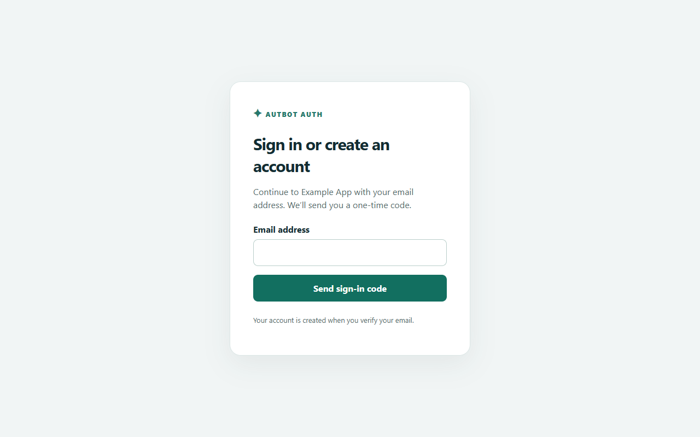
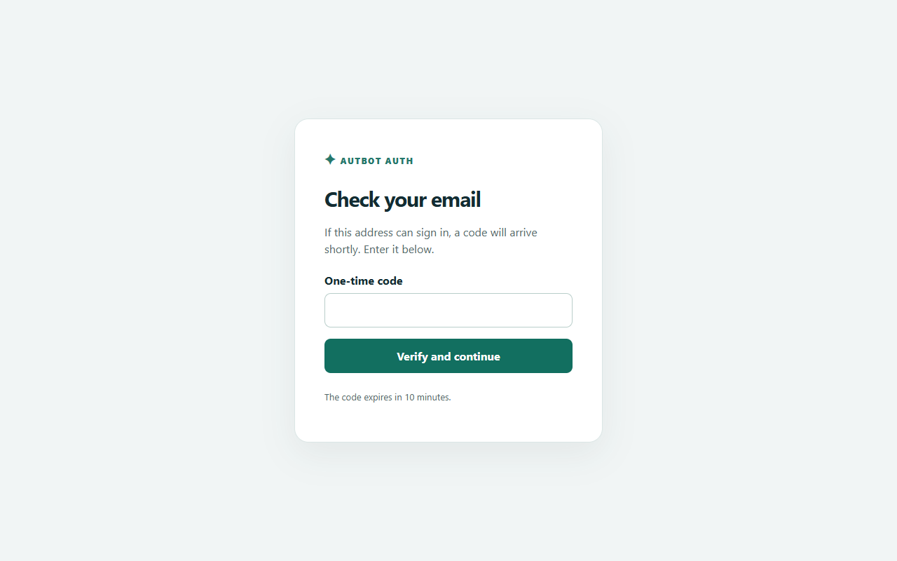

# Autbot Auth

A self-hosted OpenID Connect identity service with passwordless email sign-in and self-registration. Run one identity server and connect multiple apps that support a configurable OIDC provider.

> **Development preview:** This project has not had an independent security review. A containerized login, local TLS SMTP delivery, backup and restore, and Caddy proxy have been tested in an isolated environment. Public certificate provisioning and delivery through a real SMTP provider have not yet been tested. Do not use it for production accounts or sensitive data yet. Node's built-in SQLite module currently emits an experimental-feature warning.




## How it works

1. An app sends the user to Autbot Auth using OpenID Connect authorization code flow with PKCE.
2. The user enters their email address and a short-lived code sent to that address. A new account is created after verification.
3. The user consents and returns to the app. Returning users can reuse their identity-server session.

Open registration is enabled. Invitation-policy storage is under development but is not connected to sign-in or any app. There is no enforced app-specific user allowlist or user-facing admin dashboard yet. Everyone who can verify an email may create an account; each app must enforce its own access policy.

## Requirements

- A Linux server with Docker Engine and Docker Compose, a public DNS name pointing to it, and ports 80 and 443 reachable for HTTPS.
- An SMTP server with TLS (STARTTLS on 587, or implicit TLS on 465), credentials if required, and a verified sender address.
- An app with a configurable OpenID Connect issuer and support for authorization code flow, PKCE S256, and `client_secret_basic`.

## Installation (preview)

```sh
git clone https://github.com/kingrebelf/Autbot-auth.git
cd Autbot-auth
cp .env.example .env
# Edit .env with the public domain and SMTP settings. Keep it private.
docker compose build
docker compose run --rm --no-deps auth node src/admin.mjs init https://auth.example.com
docker compose up -d
```

Replace `auth.example.com` with the exact HTTPS origin matching `DOMAIN` in `.env`. Initialization creates the signing key and application secrets in the persistent data volume and refuses to overwrite an existing configuration. Caddy obtains a TLS certificate; DNS and ports must be ready first. You can check `https://auth.example.com/.well-known/openid-configuration` after startup.

Do not expose the Node service directly to the internet when `TRUST_PROXY=1`. The included Compose configuration exposes only Caddy, which must be the sole trusted reverse proxy. Do not use the included setup behind another proxy without correctly configuring the trusted proxy chain and forwarding headers.

## Connect an app

Register a separate client for each app, using its exact HTTPS callback URL:

```sh
docker compose exec auth node src/admin.mjs add-client my-app https://app.example.com/oidc/callback
docker compose restart auth
```

Copy the printed client secret into the app's secret store. Configure the app with the issuer (`https://auth.example.com`), client ID, secret, callback URL, `openid email` scopes, and PKCE S256. Discovery supplies the endpoints and public signing keys. Client configuration changes require a restart. Client secrets are stored in `config.json`; access to the host or backup grants access to them.

Google-only integrations may require code changes to accept another issuer. Google and Autbot Auth identify users under different issuers; migrating existing users requires an explicit, carefully verified account-linking process. Do not automatically merge accounts solely on an unverified email claim.

## Administration

```sh
docker compose exec auth node src/admin.mjs users
docker compose exec auth node src/admin.mjs disable-user USER_ID
docker compose exec auth node src/admin.mjs enable-user USER_ID
```

Disabling a user removes their identity-provider sessions and grants and blocks future authentication. Connected apps maintain their own sessions; disable or revoke those separately. Already-issued ID tokens may remain valid until they expire. Protect shell access and do not expose administrative commands as a web endpoint.

## Backup and recovery

Backups contain private signing keys, client secrets and personal data. Encrypt them, restrict access, store copies off the server, and regularly test a restore. Keep `.env` (including SMTP credentials) in a separate secure backup. Do not change client configuration while taking a backup.

```sh
# Each name must be new. This uses SQLite's online backup API.
docker compose exec auth node src/backup.mjs backup-2026-11-04
docker compose cp auth:/data/backups/backup-2026-11-04 ./backup-2026-11-04
```

To restore onto the same installation, stop the identity service, replace **both** the database and configuration together, remove the old SQLite WAL files, fix ownership, and start it again. This replaces current users, sessions, clients and keys with the backup. The example assumes the local folder is `./backup-2026-11-04`:

```sh
docker compose stop auth
docker compose run --rm --no-deps --user root --entrypoint sh auth -c 'rm -f /data/autbot.sqlite-wal /data/autbot.sqlite-shm'
docker compose cp ./backup-2026-11-04/autbot.sqlite auth:/data/autbot.sqlite
docker compose cp ./backup-2026-11-04/config.json auth:/data/config.json
docker compose run --rm --no-deps --user root --entrypoint sh auth -c 'chown node:node /data/autbot.sqlite /data/config.json && chmod 600 /data/autbot.sqlite /data/config.json'
docker compose start auth
```

Restore to the same issuer URL. Changing the issuer changes the identity namespace and can break existing app accounts. A restore may invalidate sessions or roll back recent account changes. Always rehearse recovery on an isolated test server.

## Updating

Back up the data and `.env` first, read release notes and check compatibility, then update the checkout and rebuild:

```sh
git pull --ff-only
docker compose build --pull
docker compose up -d
```

There is no automated migration or rollback system yet. Keep the previous code version and a tested backup so both can be restored together. Never use `docker compose down -v` unless you intend to delete all persistent volumes.

## Security and limitations

Codes are eight random digits, keyed before storage, bound to the login interaction, expire after ten minutes, and are single-use with a five-guess limit. Persistent hourly send limits apply per email, IP and globally. This development branch also limits sign-in-code send attempts to 80 per rolling 24 hours. Invitation emails are not implemented or counted yet; the cap cannot account for other applications using the same SMTP account, or backup rollbacks. Forms require a matching Origin, OIDC requires PKCE, and redirect URIs must be registered exactly. SMTP uses TLS. These are defenses, not a guarantee against abuse: a global quota can itself be exhausted, mail accounts can be compromised, and upstream network-level throttling and monitoring are still needed. Email alone is not MFA.

This preview does not yet offer MFA/passkeys, fine-grained per-app access control, self-service session management, an admin dashboard, a key-rotation procedure, a security audit, or production-ready observability. See [security notes](docs/SECURITY.md).

## Development

Node.js 24 or newer is required. `npm ci` installs dependencies and `npm test` runs the tests. `node scripts/screenshots.mjs` generates screenshots from a temporary in-memory demo; set `CHROME_PATH` to a local Chromium-compatible executable if necessary. Demo emails are not sent.

## License

MIT. See [LICENSE](LICENSE).
